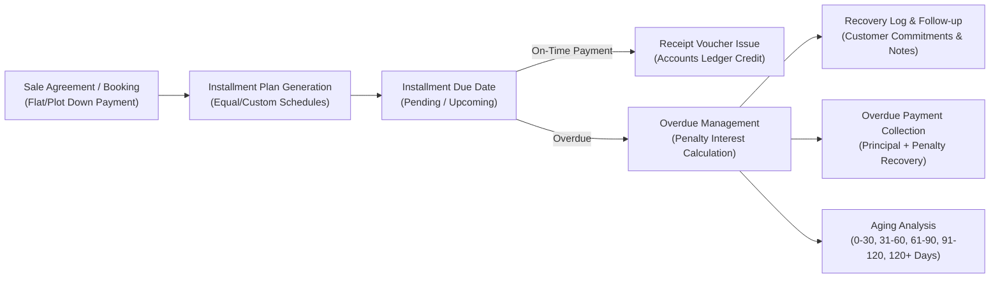

# Credit Realization (CR) Module Specification & Data Documentation

This document contains the complete technical architecture, page routes, data contracts, interactive modal forms, calculation algorithms, and live crawled datasets extracted from the **Credit Realization (CR)** module of `https://pms.somikoronitltd.com/`.

---

## 1. Executive Summary & Module Overview

The Credit Realization (CR) module is responsible for managing post-sales financial flows in real estate projects. It oversees installment schedules, automated overdue calculations, delay penalty assessments, debtor aging analysis, client collection receipts, and recovery officer follow-up actions.

### Core Lifecycle Flow:

---

## 2. Navigation Hierarchy & Route Map

| Category | Menu Item | Route URL | Key Function |
| :--- | :--- | :--- | :--- |
| **Dashboard** | CR Dashboard | `/` (active module) | Real-time recovery stats, overdue metrics, pending receipts |
| **Collections** | Receipt Voucher | `/accounts-module/receipt_list_add` | Issue collection receipts against client accounts |
| **Overdue** | Overdue list | `/credit-realization-module/installment-overdue-list` | 28 live overdue installments, penalty calculation & recovery logs |
| **Inventory / Allocation** | Flat | `/inventory-module/flat` | Units/Flats inventory status & pricing |
| | Share/Package | `/inventory-module/share/package` | Fractional share/package allocations |
| | Road & Block | `/project-module/road`, `/project-module/block` | Project plot layout structure |
| | Land Info | `/inventory-module/land` | Land/Plot allocation inventory |
| **Sales & Bookings** | Booking | `/billing/flat_land_booking_list` | 53 Flat/Plot booking agreements & down payments |
| | Sale Offer | `/billing/flat_land_sale_offer_list` | Price quotations & sale proposals |
| | Flat/Land/Share Sale | `/billing/flat_land_sale_list` | Finalized property sales agreements & schedules |
| **Reports** | Realization Summary Report | `/realization/summary-report` | 53 overall sales realizations, total paid, due & installments |
| | Sale Collection Report | `/billing/flat_land_sale_collection_report` | Detailed collection breakdowns (Rate, Utility, Parking, Down Payment) |
| | Plot Distribution Report | `/billing/plot_distribution_report` | 6 plot allocations by Block, Road, Size, and Booking money |
| | Aging Report | `/billing/aging_report` | Due aging buckets (0–30, 31–60, 61–90, 91–120, 120+ days) |
| | Installment Report | `/project-module/installment-report` | Complete schedule status (Due vs Paid per installment) |
| **Settings** | Installment Plan | `/inventory-module/installment_plan` | Configurable installment plans (Months, Interest %, Penalty %) |

---

## 3. Mathematical Formulas & Business Logic

### A. Delay Charge & Penalty Interest Formula
In PMS Credit Realization, delay charges on overdue installments are calculated dynamically when opening the payment modal:

$$\text{Daily Delay Rate} = \frac{\text{Delay Charge \%}}{100}$$

$$\text{Amortized Period Charge} = \text{Amount} \times \frac{\text{Rate}}{1 - (1 + \text{Rate})^{-1}}$$

$$\text{Interest Amount} = \text{Amortized Period Charge} - \text{Principal Amount}$$

$$\text{Penalty Amount} = \left(\frac{\text{Interest Amount} \times 1}{365}\right) \times \text{Days Overdue}$$

$$\text{Total Receivable} = \text{Installment Amount} + \text{Penalty Amount}$$

### B. Aging Bucket Classification
Delinquencies are categorized into standard real estate aging periods:
- **Current / Early:** `0–30 Days Overdue`
- **Moderate:** `31–60 Days Overdue`
- **Delinquent:** `61–90 Days Overdue`
- **Critical:** `91–120 Days Overdue`
- **Default / Legal:** `120+ Days Overdue`

---

## 4. Interactive Modals & Form Schemas

### A. Overdue Payment Modal (`.paymentModals`)
- **Trigger Button:** `.payment-receipt-btn` on Overdue List row
- **Submission:** `POST /credit-realization-module/installment-overdue-payment`
- **Fields:**
  - `installment_setup_id`: Target installment schedule ID
  - `payment_method`: `Cash` | `Bank` | `Cheque` | `bKash` | `Online Transfer`
  - `amount`: Installment principal amount
  - `penalty_percentage`: Calculated penalty charge
  - `penalty_day`: Days overdue
  - `cheque_date`: Cheque issue date (if applicable)
  - `payment_channel_id`: Target receiving bank/cash channel
  - `reconciliation_required`: Boolean flag for bank reconciliation
  - `cheque_receipt_no`: Cheque or Money Receipt Number
  - `journal_comment`: Journal narration
  - `action`: `"Overdue Payment"`

---

### B. Recovery Follow-Up Log Modal (`#statementModal`)
- **Trigger Button:** `.statement-btn` on Overdue List row
- **Submission:** `POST /credit-realization-module/installment-recovery_log-store`
- **Fields:**
  - `installment_setup_id`: Target installment schedule ID
  - `reason`: Customer reason / communication minutes
  - `next_due_date`: Promised date for collection
  - `action`: `"Follow up"`

---

### C. Installment Plan Setup Modal (`#DesignationAdd`)
- **Submission:** `POST /inventory-module/installment_plan_insert`
- **Fields:**
  - `name`: Plan Name (e.g. `24-Month Standard Residential`, `36-Month Commercial`)
  - `no_of_month`: Duration in months (e.g. `24`, `36`)
  - `interest`: Interest Rate % (Annual / Period)
  - `penalty`: Default delay penalty rate %

---

## 5. Complete API Data Dictionary

| Endpoint URL | Method | Parameters | Description |
| :--- | :---: | :--- | :--- |
| `/credit-realization-module/installment-overdue-list-data` | `GET` | `project_id` | 28 live overdue installment records with days overdue, installment due, and actions |
| `/credit-realization-module/installment-overdue-payment` | `POST` | `installment_setup_id`, `amount`, `penalty_percentage`, `payment_method`, etc. | Posts overdue installment payment and recalculates balance |
| `/credit-realization-module/installment-recovery_log-store` | `POST` | `installment_setup_id`, `reason`, `next_due_date` | Logs customer interaction and next recovery commitment date |
| `/realization/summary_report_data` | `GET` | `from_date`, `to_date`, `contact_id`, `flat_land_id` | 53 records detailing sale contracts, total grand, paid, due, and installment dates |
| `/billing/aging_report_data` | `GET` | `project_id`, `sales_by`, `date` | 17 records categorized across the 5 aging buckets |
| `/project-module/installment-report-data` | `GET` | `project_id`, `from_date`, `to_date` | Schedule records comparing scheduled amount, paid amount, and installment due |
| `/billing/flat_land_sale_collection_list_data` | `GET` | `project_id`, `from_date`, `to_date` | 53 sales records detailing cost breakdowns (rate, utility, parking, down payment) |
| `/billing/plot_distribution_report_data` | `GET` | Filter dates | 6 plot distribution records (Block, Road, Size, Booking money, installments) |
| `/billing/flat_land_booking_list_data` | `GET` | Filter dates | 53 booking agreement records |
| `/billing/flat_land_sale_list_data` | `GET` | Filter dates | 6 finalized sales records with agreement and handover dates |
| `/inventory-module/installment_plan_data` | `GET` | None | Configured installment plan templates |
| `/billing/get_flat_land_invoice/:id` | `GET` | `id` (Sale ID) | Server-rendered HTML Invoice with property and payment history |
| `/get_price_payment_schedule/:id` | `GET` | `id` (Sale ID) | Generates and streams PDF Payment Schedule |

---

## 6. Live Crawled Data Snapshots

### 1. Active Overdue Installments (28 Total Records)
| ID | Project | Flat / Unit | Customer Name | Installment Amt | Inst Due | Total Value | Overdue Days | Due Date |
| :---: | :--- | :--- | :--- | :---: | :---: | :---: | :---: | :---: |
| 1 | Sheba Eyecon Tower | F 3 | Sagor kumar | ৳10,802,680 | ৳10,802,680 | ৳10,925,000 | 40 days | 2026-09-03 |
| 2 | Lake Garden | C-10 | Abc | ৳277,916 | ৳277,916 | ৳15,340,000 | 19 days | 2026-09-24 |
| 3 | Sheba Eyecon Tower | 12B | Naima Trading | ৳3,250,000 | ৳3,250,000 | ৳40,000,000 | 17 days | 2026-09-26 |
| 15 | Sheba Eyecon Tower | F 4 | Sagor kumar | ৳964,166 | ৳964,166 | ৳11,770,000 | 6 days | 2026-10-07 |
| 16 | Lake Garden | Siver | Md Razib | ৳3,600,000 | ৳3,600,000 | ৳3,600,000 | 6 days | 2026-10-07 |
| 17 | Lake Garden | Siver | Tazmul | ৳250,000 | ৳250,000 | ৳3,000,000 | 6 days | 2026-10-07 |

### 2. Aging Bucket Portfolio Total
| Bucket Period | Total Outstanding Delinquency |
| :--- | :---: |
| **0 – 30 Days** | ৳3,278,166.66 |
| **31 – 60 Days** | ৳3,278,166.66 |
| **61 – 90 Days** | ৳964,166.66 |
| **91 – 120 Days** | ৳3,278,166.66 |
| **120+ Days** | ৳9,063,166.70 |
| **Total Outstanding Portfolio Due** | **৳19,861,833.34** |
