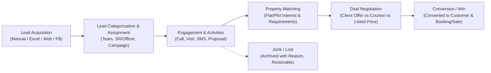

# CRM (Customer Relationship Management) Module Specification & Data Documentation

This document contains the complete technical architecture, page routes, data contracts, interactive modal forms, action workflows, and live crawled datasets extracted from the **CRM Module** of `https://pms.somikoronitltd.com/crm-module`.

---

## 1. Executive Summary & Module Overview

The CRM module within PMS manages the full real estate customer acquisition lifecycle—from lead capture and source attribution through sales officer allocation, multi-channel communication (calls, SMS, WhatsApp, proposals), site visits, property requirements tagging, price negotiations, deal approvals, and customer conversion.

### Core Lifecycle Flow:

---

## 2. Navigation Hierarchy & Route Map

| Category | Menu Item | Route URL | Key Function |
| :--- | :--- | :--- | :--- |
| **Dashboard** | CRM Dashboard | `/crm-module` | Action widgets: New Leads, Today's Activities, Follow-ups, Visits |
| **Lead Operations** | Lead Accounts List | `/crm-module/add-lead-account` | Master Lead DataTable (132 leads), filtering, bulk assign, SMS |
| | Lead Details | `/crm-module/lead-details/:id` | 360° lead view, journey bar, activity tabs, call logs, attachments |
| | Junk Leads | `/crm-module/junk-add-lead-account` | Soft-deleted / discarded leads with restore/purge controls |
| | Transfer History | `/crm-module/transfer-call-list` | Audit trail of lead transfers between officers |
| | Call Assign History | `/crm-module/call-assign-history` | Audit log of assigned calls per officer |
| **Negotiations** | Deal Negotiation Activity | `/crm-module/deal-negotiation-activity-list` | Multi-round pricing negotiations, approval/rejection modal flow |
| **Master Settings** | Teams | `/crm-module/teams` | Sales teams and hierarchical agent assignments |
| | Lead Category | `/crm-module/lead_category` | High / Medium / Low / Investor classifications |
| | Campaigns | `/crm-module/campaign` | Marketing campaigns (FB Ads, Expos, Print, Digital) |
| | Professions | `/crm-module/profession` | Lead professions (Doctor, Engineer, Businessman, Banker, etc.) |
| | Lead Source | `/crm-module/add-lead-source` | Acquisition source (Facebook, Website, Referral, Walk-in) |
| | Offers / Features | `/crm-module/feature` | Special promotions / discount schemes |
| | Area | `/crm-module/area` | Geographical territories (Uttara, Dhanmondi, Gulshan, Mirpur) |
| | Lead Stages | `/crm-module/lead_status` | Status pipeline (New, Contacted, Prospect, Opportunity, Won) |
| | Price Range | `/crm-module/price-range` | Budget brackets for property buyers |
| | Requirement Type | `/crm-module/requirement-type` | Residential, Commercial, Land, Fractional |
| | Visit Places | `/crm-module/visit_places` | Project sites, Corporate office, Model flats |
| | Visit Status | `/crm-module/visit_status` | Scheduled, Completed, Missed, Rescheduled |
| | Task Type | `/crm-module/task_type` | Activity types (Call, Meeting, Site Visit, Email, Document) |
| | Internal Tasks | `/crm-module/internal-tasks` | Internal agent collaboration tasks with priority & status |
| **Reporting & Analytics** | Visit/Task Summary | `/crm-module/visit-task-report` | Aggregated visit and task completion rates |
| | Visit/Task Details | `/crm-module/visit-details-report` | Granular log of customer visits per site |
| | Call Details Report | `/crm-module/call-details-report` | Detailed call logs with feedback notes and duration |
| | User Wise Call/Task | `/crm-module/user-wise-call-task-report` | Performance matrix per sales representative |
| | User Activity Report | `/crm-module/user-wise-activity-report` | Real-time audit trail of user CRM actions |
| | Source Wise Lead | `/crm-module/source-wise-lead-report` | Lead volume and ROI per marketing source |
| | Sales Pipeline Funnel | `/crm-module/sales-pipeline-funnel-report` | Conversion funnel from Lead to Closed Deal |
| | Team Wise Lead | `/crm-module/team-wise-lead-report` | Aggregated team quotas and conversions |
| | Interested Flat/Land | `/crm-module/flat-land-interest-list` | Tagged property interests across active leads |
| | Requirements List | `/crm-module/see-requirements` | Specific buyer criteria (Size, Bedrooms, Budget) |
| | Sales Probability | `/crm-module/sales-probability` | Probability-weighted revenue pipeline |
| | Missed Followup Report| `/crm-module/missed-followup-list-report` | Overdue follow-up calls and visits per team/user |
| | Deal Negotiation Report| `/crm-module/deal-negotiation-report` | History of counter offers and final prices |
| | Call Log Report | `/crm-module/call-log-report` | Telephony call records and sync status |
| | Call Log Details | `/crm-module/call-log-details-report` | In-depth recording links and call metadata |

---

## 3. Interactive Modals & Form Schemas

### A. Lead Creation Modal (`#LeadDataInsertModal`)
- **Submission:** `POST /crm-module/lead-account-insert`
- **Fields:**
  - `name`: Lead Full Name (Required)
  - `mobile`: Primary Phone (Required)
  - `secondary_mobile`: Secondary Phone / Alternative
  - `email`: Email Address
  - `company`: Organization / Employer Name
  - `designation`: Job Title
  - `address`: Residential / Office Address
  - `lead_category_id`: Lead Priority Category
  - `profession_id`: Profession dropdown
  - `lead_source_id`: Acquisition Source
  - `campaign_id`: Associated Marketing Campaign
  - `project_id`: Interested Project
  - `area_id`: Target Location Area
  - `price_range_id`: Budget Bracket
  - `assign_user_id`: Assigned Sales Representative (SR)
  - `cr`: Credit Realization Officer Assigned
  - `remark`: Initial Consultation Notes
  - `query`: Customer Specific Requirements

---

### B. Master Activity / Quick Action Modal (`#MyLeadModal`)
Triggered via `.myLeadPopup` on any lead row to log communication, update status, or plan next actions.
- **Data Load:** `GET /crm-module/followup/new/call?id=:leadId&call_id=:callId&visit_id=:visitId`
- **Submission:** `POST /crm-module/lead-modal-insert`
- **Sections & Controls:**
  1. **Current Activity Log:**
     - Activity Type Radio: `current_followup` (Call/Note) vs `current_visit` (Site/Office Visit)
     - `communication_status`: Call Outcome (Answered, Not Picked, Busy, Switched Off)
     - `sales_possibility`: High / Medium / Low / Closed
     - `note`: Call / Meeting Minutes
     - `comment`: Actionable feedback
  2. **Next Scheduled Activity:**
     - Next Activity Radio: `followup` (Next Call) vs `visit` (Next Meeting)
     - `next_date`: DateTime Picker for reminder
     - `visit_place_id`: Site or Office location
     - `visit_note`: Objective of the visit
  3. **Stage Progression:**
     - `lead_status`: Pipeline Stage update (e.g., Prospect -> Opportunity -> Negotiation)
  4. **Junk Trigger:**
     - Checkbox: `moveToJunk`
     - `junk_note`: Justification reason for archiving lead
  5. **Direct Channel Actions:**
     - `WhatsApp`: Direct web whatsapp trigger with lead phone
     - `SMS`: Triggers `#SmsAddFromModal` with pre-defined templates
     - `Proposal/Email`: Triggers `#AttachmentAddFromModal` to attach PDF proposals and send via email

---

### C. Deal Negotiation Modal & Workflow
- **Data Endpoint:** `GET /crm-module/deal-negotiation-activity-list-data`
- **Actions:**
  - **Submit Counter-Offer:** `activity_type = 'counter_offer'`
  - **Approve Deal:** `POST /crm-module/deal-negotiation-activity-approve`
  - **Reject Deal:** `POST /crm-module/deal-negotiation-activity-reject`
  - **Reassign Deal:** `POST /crm-module/deal-negotiation-activity-reassign`
- **Fields Tracked:**
  - `listed_price`: Baseline Unit Price
  - `client_offered_price`: Buyer's Proposal
  - `counter_price`: Company Counter Proposal
  - `final_agreed_price`: Approved Sale Price
  - `discount_amount` & `discount_percent`
  - `payment_term`: Down payment % and Installment count
  - `special_condition`: Car parking / floor / finishing terms
  - `round_no`: Negotiation iteration count (Round 1, 2, 3...)

---

## 4. Complete API Data Dictionary

| Endpoint URL | Method | Query / Payload Parameters | Response Summary |
| :--- | :---: | :--- | :--- |
| `/crm-module/lead_data` | `GET` | `from_date`, `to_date`, `project_id`, `team_id`, `source_id`, `lead_cat_id`, `profession_id`, `assign_user_id`, `lead_stages`, `converted_customer`, `keyword` | DataTable JSON of 132 leads with activity badges and action buttons |
| `/crm-module/lead_code_generate` | `GET` | None | Returns next sequential Lead ID (e.g. `L261012-0133`) |
| `/crm-module/lead-account-insert` | `POST` | Full lead form data (name, mobile, company, etc.) | Created lead object, HTTP 200/201 |
| `/crm-module/lead-account-edit` | `POST` | `id` + updated lead properties | Updated lead object |
| `/crm-module/bulk-lead-account-insert` | `POST` | `multipart/form-data` with CSV/Excel file | Batch import count and validation errors |
| `/crm-module/lead-modal-insert` | `POST` | `lead_id`, `communication_status`, `sales_possibility`, `note`, `next_date`, `lead_status` | Success response, triggers table reload |
| `/crm-module/convert-customer` | `POST` | `lead_id`, `customer_code`, `opening_balance` | Converts Lead to Customer Entity for Booking |
| `/crm-module/bulk-delete-lead` | `POST` | `lead_ids: []` | Soft deletes selected leads |
| `/crm-module/bulk-lead-transfer` | `POST` | `lead_ids: []`, `from_user_id`, `to_user_id`, `note` | Transfers ownership between sales officers |
| `/crm-module/lead-bulk-assign-call` | `POST` | `lead_ids: []`, `assign_user_id`, `scheduled_date` | Assigns call tasks |
| `/crm-module/deal-negotiation-activity-list-data` | `GET` | `project_id`, `lead_id`, `status` | 8 multi-round price negotiation records |
| `/crm-module/flat-land-interest-list/data` | `GET` | `project_id`, `status` | 12 property-tagged lead interest records |
| `/crm-module/sales-probability-data` | `GET` | `stage_id`, `user_id` | 132 probability-weighted pipeline records |
| `/crm-module/user-wise-activity-report-data` | `GET` | `user_id`, `from_date`, `to_date` | Agent audit logs (Call, Visit, Note) |
| `/crm-module/internal-tasks/data` | `GET` | `project_id`, `status`, `assigned_to` | 13 internal team task items |
| `/crm-module/transfer-call-list-data` | `GET` | Filter dates | 6 historical transfer audit records |
| `/crm-module/call-assign-history-data` | `GET` | Filter dates | 8 historical call assignment records |
| `/crm-module/junk_lead_data` | `GET` | `from_date`, `to_date` | 2 discarded leads with restore actions |
| `/crm-module/lead_category_data` | `GET` | None | 6 categories (High, Medium, VIP, etc.) |
| `/crm-module/campaign_data` | `GET` | None | 11 active marketing campaigns |
| `/crm-module/profession_data` | `GET` | None | 13 profession classifications |
| `/crm-module/lead_source_data` | `GET` | None | 12 acquisition sources |
| `/crm-module/area_data` | `GET` | None | 6 location areas |
| `/crm-module/lead_status_data` | `GET` | None | 15 pipeline stages |

---

## 5. Live Crawled Data Snapshots

### 1. Active Leads Portfolio (132 Records Sample)
From `GET /crm-module/lead_data`:
- **Lead `L261012-0132` (Kazi Mohammad Aseem):**
  - **Phone:** `+8801963 610277`
  - **Company:** Madina Group
  - **Designation:** Executive Director
  - **Stage:** Prospect
  - **Officer:** Admin
  - **Last Activity:** Call (12-10-2026, Status: Follow Up, Comment: "test")
  - **Next Activity:** Call scheduled for 31-10-2026

### 2. Deal Negotiation Pipeline (8 Records Sample)
From `GET /crm-module/deal-negotiation-activity-list-data`:
- **Lead #697 (Lake Garden - Flat 288):**
  - **Activity:** Offer
  - **Listed Price:** ৳50,000.00 / SFT
  - **Client Offer:** ৳45,000.00 / SFT
  - **Counter Price:** ৳40,000.00 / SFT
  - **Round:** 1
  - **Status:** Pending Review

### 3. Interested Property Tagging (12 Records Sample)
From `GET /crm-module/flat-land-interest-list/data`:
- **Project:** Sheba Eyecon Tower
- **Interest Status:** Tagged to active leads awaiting booking allocation.

### 4. Master Categorization Metrics
- **Lead Categories (6):** VIP, Regular, Corporate, High Value, Investor, General
- **Campaigns (11):** Facebook Campaign 2026, Summer Expo, Digital Ads, REHAB Fair, Billboard Ads, etc.
- **Professions (13):** Doctor, Engineer, Corporate Banker, Business Owner, Government Official, NRB/Expatriate, etc.
- **Lead Sources (12):** Social Media, Cold Call, Referral, Walk-in Visitor, Website Lead Form, Property Portal.
- **Lead Stages (15):** New Inquiry, Contact Established, Needs Analysis, Prospect, Site Visit Completed, Offer Submitted, Counter Negotiating, Verbal Commitment, Converted to Customer, Closed Lost.
- **Internal Tasks (13):** Pending team deliverables assigned across Rasel Hosain, Mohin, and Admin.
